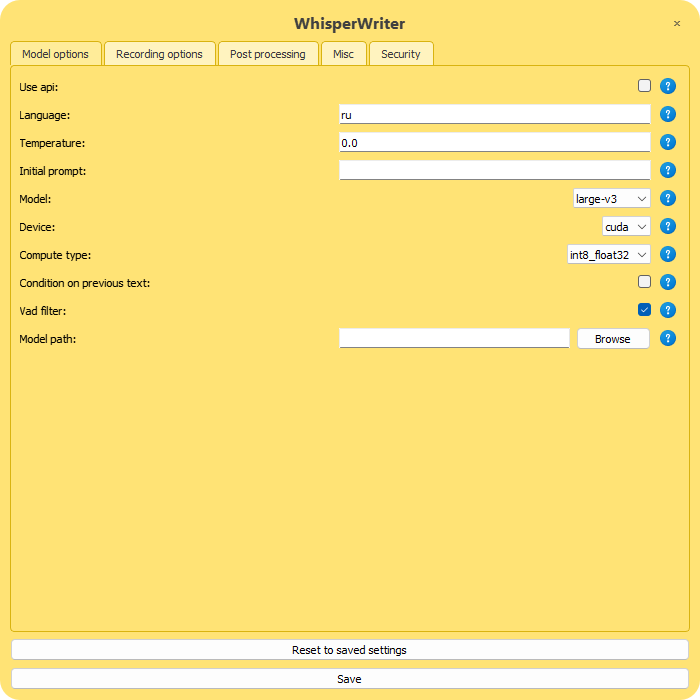
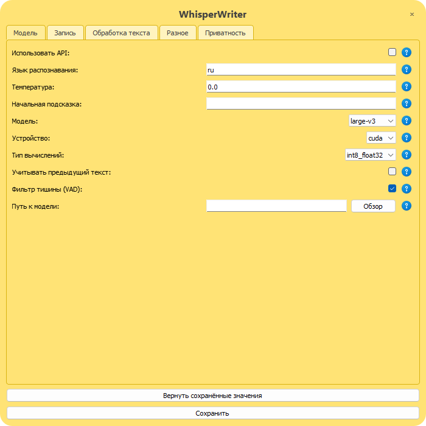

# WhisperWriter — Windows hardening fork

Local, offline speech-to-text for Windows. Press a key, talk, stop talking — the
recognised text is typed into whatever window has focus. No account. The first
run downloads the speech model; after that no internet is needed and no audio
leaves the machine. An optional cloud mode sends audio to OpenAI instead — it is
off unless you turn it on.

This is a fork of **[savbell/whisper-writer](https://github.com/savbell/whisper-writer)**.
The upstream project provides the application; this fork makes it survive daily use
on Windows. Every change here came out of an actual failure, and the sections below
say which one — what broke, why, and how it was proved fixed.

<p align="center">
  
</p>

<p align="center">
  
</p>

---

## What this fork changes

### Failures are no longer silent

Under `pythonw.exe` there is no console, so Python sets `sys.stdout` and `sys.stderr`
to `None` and **drops every `print()` and every traceback on the floor**. A recording
that failed left no trace anywhere: the status window blinked once and nothing was
typed. It read as a crash.

- `attach_log_files()` in `src/main.py` points both streams at `ww_out.log` /
  `ww_err.log` when no console is attached. Paths are derived from the source file
  rather than the working directory, so they land correctly regardless of how the
  app was started.
- `ResultThread` gained an `errorSignal`; the app turns it into a dialog that names
  the cause — microphone unavailable, no speech heard, nothing recognised — instead
  of failing quietly.

### A recording can no longer run forever

In `voice_activity_detection` mode the only exit from the recording loop was
"speech was heard, then N ms of silence". A muted or dead microphone never raises
the speech flag, which makes that exit **unreachable** — the recording ran until the
user cancelled it by hand, and the app looked frozen.

- A recording with no speech at all now stops after 25 s and explains why.
- Any recording is capped at 5 minutes; audio captured so far is still transcribed.
- The frame wait got a timeout, so a stalled audio callback can no longer block
  `stop()` and freeze the GUI thread along with it.

### The settings window no longer corrupts falsy values

`SettingsWindow.get_config_value()` returned `ConfigManager.get_config_value(...) or
meta['value']`. Since `False or True` is `True`, **any falsy config value was replaced
by the schema default** when the widget was built — and pressing Save wrote that
default back to disk, silently flipping the setting. Replaced with an explicit
`is None` check.

### Native DLL crash on startup

`import ctranslate2` must come **before** PyQt5 in `src/main.py`, or Windows raises
a fatal access violation from conflicting native runtimes. Three lines, carrying a
comment that says not to "tidy up" the import order.

### Starts ready to use, and stops leaking hooks

Upstream shows a main window on every launch and does nothing until its **Start**
button is clicked — the dictation key is dead until then. This fork starts the key
listener as soon as the model is loaded and stays in the tray.

Doing that exposed a second problem: `PynputBackend.start()` built fresh keyboard
and mouse hooks **without stopping the previous ones**, and the app calls it again
after every transcription. Hooks accumulated for the life of the process, each one
delivering the same key event to the callbacks another time. `start()` now stops
what it started, so the count stays at two no matter how long the app runs.

### The microphone stays shut outside dictation

Windows leaves a capture device open to every process all day. This fork can
invert that: with the gate on, the microphone stays closed and a dictation opens
it for the few seconds it records. Controlled by `security.mic_gate` in
`src/config.yaml` (`off`, `mute`, `consent`, `both`). It ships `off` — closing
the microphone affects every application, so turning it on is your call; see
[Configuration](#configuration).

Two levers, and they are not equally strong:

| Lever | Protects against | Undone by |
| --- | --- | --- |
| `consent` — HKCU CapabilityAccessManager | browsers, meeting apps, anything opening a mic unasked | any code running as this user |
| `mute` — endpoint mute flag | accidental hot-mic; makes the state visible in the volume UI | any process, in one call |

Neither stops code that already runs as you. **The only real guarantee is the
hardware mute button on the microphone.** The gate removes the always-listening
default; it is not a defence against malware, and it would be dishonest to
present it as one.

`src/mic_gate.py` never raises: a gate that cannot close is a privacy problem,
but a gate that throws is a broken application. Failures are logged and swallowed.
The gate shuts on app start, after every recording, on exceptions during a
recording, and at exit — closed is the fail-safe direction.

The mute lever holds its COM pointers for the life of the process and never
releases them, which is deliberate. A comtypes proxy that goes out of scope
lands in a reference cycle, so its `Release()` is left to the cyclic garbage
collector — running at an arbitrary later moment on whatever thread happens to
allocate. On this machine that release faults every time. Usually ctypes catches
it and prints an ignored `__del__` traceback; once it did not, and the collector
fired inside onnxruntime's DLL load during a transcription and took the whole
process with it. Building the device enumerator by hand instead of through
`AudioUtilities.GetMicrophone()`, and keeping every intermediate pointer alive,
leaves the collector nothing to release.

Two supporting pieces live in `tools/`:

- `mic-guard.ps1` — `-Status`, `-Open`, `-Close`, `-Audit`. No administrator
  rights needed. `-Audit` reads the usage journal Windows itself keeps, showing
  which applications held the microphone and when, and which hold it right now.
  Use `-Open` when you need the microphone for a call.
- `mic-guard-task.xml` — a Task Scheduler job that closes the microphone after
  five minutes of idle, as a backstop for when WhisperWriter exits without
  restoring the state. It is a template: `__PROJECT_DIR__` stands for the folder
  you cloned into, and the task carries no account, so registering it fills in
  whoever ran the command. From the project root:

  ```powershell
  $xml = (Get-Content tools\mic-guard-task.xml -Raw) -replace '__PROJECT_DIR__', $PWD.Path
  Register-ScheduledTask -TaskName 'WhisperWriter Mic Guard' -Xml $xml -Force
  ```

  No administrator rights needed. Change the idle threshold in the XML's
  `<Duration>` field. Remove it again with
  `Unregister-ScheduledTask -TaskName 'WhisperWriter Mic Guard'`, or keep it and
  switch it off with `Disable-ScheduledTask` — worth knowing, because an idle
  trigger that closes the microphone to every desktop application will also
  stop voice messages working in a chat application until the gate is reopened.

### Transcription runs on the GPU

Two things kept a perfectly usable GPU idle, and both failed quietly.

CTranslate2 does not link cuBLAS at load time — it asks Windows for
`cublas64_12.dll` by name at the **first encode**. When that library comes from
the `nvidia-cublas-cu12` wheel it sits inside `site-packages`, where nothing
looks for it. So the model loaded, reported success, and then died in the middle
of a transcription:

```text
RuntimeError: Library cublas64_12.dll is not found or cannot be loaded
```

`os.add_dll_directory` does not fix this — it only affects loads that opt into
the newer search flags, and CTranslate2's does not. Prepending the directories to
`PATH` does, because that is one of the places a plain `LoadLibrary` looks. That
is all `src/cuda_libs.py` is.

The second was a rule in upstream forcing `compute_type: int8` onto the CPU. It
ruled out exactly the case it was needed for: a card without usable float16 —
anything Pascal or older — is precisely where int8 is the right *GPU* choice.

A GPU that cannot actually run now falls back at startup rather than halfway
through a dictation. `create_local_model` runs a two-frame encode before handing
the model over, because constructing a CUDA model succeeds on a machine that has
a driver but no CUDA runtime; only the first encode tells the truth.

**Measured**, 29.6 s of speech, the same audio through every setup:

| Setup | Time | Speed |
| --- | --- | --- |
| large-v3, GPU, int8_float32 | 6.17 s | 4.80× realtime |
| small, GPU, int8_float32 | 1.72 s | 17.18× realtime |
| small, CPU, int8 | 7.80 s | 3.80× realtime |
| medium, GPU, int8_float32 | 10.94 s | 2.71× realtime |

On a GTX 1050 Ti — a modest card — **large-v3 on the GPU is faster than the small
model was on the CPU**, so there is no accuracy/speed trade to make.

And on 61 words of real speech through a real microphone, scored against what was
actually said:

| Setup | Errors | WER |
| --- | --- | --- |
| large-v3, GPU | 0 of 61 | 0.0 % |
| medium, GPU | 3 | 4.9 % |
| small, GPU | 5 | 8.2 % |
| small, CPU | 7 | 11.5 % |

The small model's mistakes were not near misses — it produced *сентябра*, *ворту*
and *шипелявлю*, none of which are words. `medium` is best avoided for a separate
reason: on one sample it invented a YouTube sign-off that was never spoken, a
known artefact of its training data.

### English and Russian interface

Upstream's interface is English only, while this fork's error messages had grown
Russian — a mix that served neither reader. Both languages now come from one
catalogue in `src/i18n.py`, chosen by `misc.ui_language` (`en` or `ru`).

English is the source language: every string appears in the code as its English
text and the catalogue maps it to Russian. A string with no entry falls through
unchanged, so a missing translation shows English rather than a blank. Labels and
help text in the settings window are translated from the English text the schema
key produces, which leaves `config_schema.yaml` untouched and easy to merge from
upstream.

Widgets read their text once, when they are built, so the language takes effect
on the next start. Saving settings already restarts the app, which is the only
way the setting can change.

<p align="center">
  
  &nbsp;&nbsp;
  
</p>

<p align="center">
  
</p>

### Switching the dictation language, and dictating across one

The interface language and the dictated language are separate settings, and the
second one changes far more often — anyone working in two languages switches
several times a day. Upstream puts it in the settings window, where saving
restarts the application and reloads the model, which is too much ceremony to
perform between two sentences.

It is also unnecessary. `transcription.py` reads the language on every dictation
and the multilingual model is the same model whatever the answer, so the tray
menu now offers **Dictation language** — auto-detect, English, Russian — and the
next dictation obeys it. No restart, no reload, and the tray tooltip shows which
one is active. The choice lasts for the session; the config file keeps the
language this machine usually works in, and a restart returns to it.

Worth knowing, because it is easy to trip over and occasionally useful on
purpose: **this setting is the language Whisper writes in, not a filter on what
it hears.** Speak English with Russian selected and you get Russian text — the
model bridges the gap by translating. It is not a translator and makes no
promises: given clean audio it often transcribes the spoken language instead,
so treat the behaviour as available rather than reliable. Whisper's documented
translation mode only ever targets English; this is the other direction, and it
arrived by accident.

Auto-detect has its own edge: on accented speech the reported language can be
wrong while the text is right — English spoken with a Russian accent was
measured here as `ru` with probability 0.81, transcribed correctly as English.
Naming the language explicitly is the way to be certain of the output.

### Text arrives as the words that were said

Windows keyboard input carries a *key position*, not a letter — the receiving
window decides what the position means by running it through its own keyboard
layout. pynput types a character by asking `VkKeyScan` which key produces it
**under the sending process's layout**, and when that key needs no modifier it
injects the key. Character in, key position out.

The two sides agree only while they are in the same layout, and dictation types
into whatever window happens to be in front:

```
sent from a US layout, into a Russian-layout window
  "Пункт, ещё раз. Hello, world."   ->   "Пунктб ещё разю Hуддщб цщкдвю"

sent from a Russian layout, into a US-layout window
  "Пункт, ещё раз. Hello, world."   ->   "tuПeyrnj, to` hfp/ Hello, wo rld/"
```

Not a transcription error — the model had produced the sentence correctly, and
the text was mangled on its way into the window. Cyrillic survived the first
case only by accident: `VkKeyScan` cannot place "п" on a US layout, so pynput
fell back to sending the character itself. Which is what `win_input.py` now
does for everything, through `SendInput` with `KEYEVENTF_UNICODE`: the
character is the payload, and no layout is left in the path to reinterpret it.

pynput remains the fallback for other platforms, and for the case where Windows
refuses the injection outright — a window running elevated, where no simulated
input of any kind gets through. That refusal is now reported instead of
appearing as text that silently never arrives.

### Windows integration

- `start-dictation.bat` — launcher; refuses to start a second instance.
- `stop-dictation.bat` + `stop-whisperwriter.ps1` — stops only the Python
  process running this project, matched on its command line, so other Python
  programs are never touched.
- `debug-dictation.bat` — debug launcher: real console, both streams to log files,
  window stays open and prints stderr on exit.
- Settings are per machine and stay out of git; saving them keeps a dated backup.

---

## How it works

One dictation, end to end:

1. `key_listener.py` watches the keyboard with a low-level `pynput` hook. It
   observes rather than consumes, so the activation key still reaches whatever
   window has focus.
2. `main.py` starts a `ResultThread`. Everything below happens off the GUI
   thread, so the interface never blocks on a model.
3. `mic_gate.py` opens the microphone — lifting the Windows capability denial
   and the endpoint mute — and a `sounddevice` stream delivers 30 ms frames at
   16 kHz.
4. `result_thread.py` runs each frame past a WebRTC voice activity detector,
   counting silent frames. A long enough pause after speech ends the recording;
   so does 25 s with no speech at all, or five minutes in total.
5. The gate shuts again on the way out of the recording block, including when
   the block raises.
6. `transcription.py` hands the samples to faster-whisper — CPU or GPU — and
   post-processes the text.
7. `input_simulation.py` types the result into the focused window — as
   characters, via `win_input.py`, so the keyboard layout of that window cannot
   change what was said.

Where things live:

| File | Responsibility |
| --- | --- |
| `src/main.py` | wiring, tray icon and its language switch, error dialogs, log files |
| `src/result_thread.py` | recording loop, voice activity detection, timeouts |
| `src/transcription.py` | model creation, device fallback, decoding |
| `src/mic_gate.py` | the microphone privacy gate |
| `src/cuda_libs.py` | makes the pip-installed CUDA runtime loadable |
| `src/win_input.py` | layout-independent typing via `SendInput` |
| `src/i18n.py` | the English/Russian catalogue |
| `src/key_listener.py` | keyboard backends and shortcut parsing |
| `src/ui/` | the frameless windows and the settings form |
| `tools/` | microphone guard script and its scheduled task |

## Platform support

This is a Windows fork and Windows is where it is used and tested. Upstream was
cross-platform, and the parts this fork added had quietly taken that away: the
microphone gate imported `winreg` at module level, and `main.py` imports the
gate unconditionally, so the application stopped on its first import anywhere
else. The Windows-specific modules are now guarded and inert elsewhere.

| | Windows | Linux |
| --- | --- | --- |
| Starts, records, transcribes, types | yes | expected, not yet run end to end |
| Layout-independent typing (`win_input.py`) | yes | not needed; pynput, or ydotool on Wayland |
| Microphone gate | yes | **no** — says so in the log and stays inert |
| GPU helper (`cuda_libs.py`) | yes | no — falls back to the CPU at startup |
| Launchers | `.bat` / `.ps1` | none yet |

What was actually verified on Linux, under Python 3.10 on Ubuntu 22.04: every
module that touches Windows imports, `mic_gate` reports `supported: False` and
its open, close and session calls return without raising, `win_input.typewrite`
refuses with a clear message rather than a `NameError`, and `cuda_libs.enable()`
finds nothing and says so. The application itself has **not** been run there —
PyQt5 and CTranslate2 were not installed — so the first row above is a
reasonable expectation, not a measurement.

Three things stand between that and a working Linux version: launcher scripts,
a `ctypes.CDLL` equivalent of the CUDA helper (the dynamic loader reads
`LD_LIBRARY_PATH` at process start, so the Windows trick of editing it from
inside the process cannot work), and a microphone gate built on PipeWire, which
is a different design rather than a port — the Windows capability broker has no
counterpart.

## Requirements

Tested on Windows 11 with **Python 3.11**. Newer Pythons may work, but 3.11 is what
this fork runs on; the dependency set below is the one known to be good.

| Package | Version |
| --- | --- |
| faster-whisper | 1.2.1 |
| ctranslate2 | 4.8.0 |
| PyQt5 | 5.15.11 |
| numpy | 1.26.4 (pinned below 2) |
| av | 17.1.0 |
| sounddevice | 0.5.5 |
| soundfile | 0.14.0 |
| pynput | 1.8.2 |
| webrtcvad-wheels | 2.0.14 |
| PyYAML | 6.0.3 |
| audioplayer | 0.6 |

Transcription runs through CTranslate2, on the CPU or on an NVIDIA GPU. Neither
`torch` nor `numba` is needed. Models are downloaded on first run: `small` is
about 460 MB, `large-v3` about 3 GB.

### For the GPU (optional)

An NVIDIA card with the CUDA 12 runtime. The runtime comes from pip, not from a
CUDA Toolkit install:

| Package | Purpose |
| --- | --- |
| nvidia-cublas-cu12 | the library CTranslate2 asks for at the first encode |
| nvidia-cudnn-cu12 | required by CTranslate2 4.5 and newer |

Check what your card supports before choosing `compute_type`:

```bash
venv\Scripts\python.exe -c "import ctranslate2; print(ctranslate2.get_supported_compute_types('cuda'))"
```

A Pascal card (GTX 10xx) will not list `float16` — use `int8_float32`. Skipping
the GPU entirely is fine; the app falls back to the CPU on its own.

## Installation

```bash
git clone https://github.com/schwarzmeewolf/offline-dictation-windows.git whisper-writer
cd whisper-writer
py -3.11 -m venv venv
venv\Scripts\python.exe -m pip install PyQt5 faster-whisper sounddevice soundfile ^
    pynput webrtcvad-wheels PyYAML openai audioplayer python-dotenv pycaw "numpy<2"
```

`requirements.txt` holds the same list and is equivalent:

```bash
venv\Scripts\python.exe -m pip install -r requirements.txt
```

It pins direct dependencies only and leaves the rest to pip. Upstream's version
pinned the entire closure, including packages this app never imports.

For GPU transcription, add:

```bash
venv\Scripts\python.exe -m pip install -r requirements-gpu.txt
```

Nothing else is needed — `src/cuda_libs.py` finds those wheels wherever pip put
them and makes them loadable.

## Running

```bash
venv\Scripts\pythonw.exe src\main.py
```

**The working directory must be the project root.** Paths in `utils.py` and
`main.py` are relative and hardcoded; started from anywhere else the app does not
fail — it silently ignores your config and opens the first-run settings window. The
launcher `.bat` files handle this with `cd /d`.

The bundled `.bat` files derive every path from their own location, so the project
can live anywhere and a desktop shortcut still works.

On first run there is no `src/config.yaml` yet, so the settings window opens;
Save writes it and restarts into it. After that the app loads the model, starts
listening and stays in the tray — no window to dismiss, no button to press. The main window is still reachable from the tray menu; note
that closing it with the `×` **quits the application** rather than hiding it.

## Configuration

There are two files, and the split matters:

| File | What it is | In git? |
| --- | --- | --- |
| `src/config_schema.yaml` | every option, its allowed values, and the default | yes |
| `src/config.yaml` | the settings on *this* machine | no |

`config.yaml` is written by the settings window, not by hand, and it is ignored
by git on purpose. Tracking it would mean shipping one person's language, model
and hotkey to everyone who clones, and leaving every clone permanently modified
the moment its owner changed a setting.

A missing `config.yaml` is not an error. On first run the app opens the settings
window, filled in from the schema; Save writes the file and restarts into it.
Saving also keeps a dated copy of the previous file — `config.yaml.backup-<date>`,
five most recent — because the save is wholesale and drops anything it did not
round-trip.

The defaults are this fork's, not upstream's:

```yaml
model_options:
  local:   { model: small, device: auto, compute_type: int8_float32,
             condition_on_previous_text: false, vad_filter: true }
recording_options:
  activation_key: pause
  recording_mode: voice_activity_detection
  silence_duration: 2000    # pause that ends a recording, ms
```

Two of them are deliberately *not* set to what this machine runs:

- **`model: small`, not `large-v3`.** On a GPU, large-v3 wins on accuracy and
  speed both (see the table above) — but on a machine without one it is
  unusable, and the default has to work everywhere. Switch it in the settings
  window once you know you have a GPU.
- **`mic_gate: off`.** The gate closes the microphone for *every* application,
  not just this one. That is a system-wide change to make knowingly, so it stays
  opt-in. Turn it on in Settings → Security once you have read what it does.

Two traps worth knowing:

- **Key names come from the `KeyCode` enum in `key_listener.py`.** The Windows key
  is `meta`, not `win` or `cmd`. An unrecognised name is *not* an error — the parser
  prints `Unknown key:` and drops it from the combination, leaving a shortcut that
  quietly does the wrong thing. Since this fork writes logs, that line is now
  visible in `ww_out.log`.
- **`open()` is called without `encoding=`** when reading the schema and reading or
  writing the config. On a non-UTF-8 Windows locale this decodes as the system code
  page. Comments survive because YAML discards them after decoding, but **non-ASCII
  values would break loading.** Add `encoding='utf-8'` in `utils.py` first if you
  need one.

### Choosing an activation key

Modifier combinations collide with keyboard-layout switching more often than you
would expect. On a machine with several layouts, `Ctrl+Shift` and `Alt+Shift` are
usually the layout switchers, and Windows reserves the **entire** `Win+Space` family
for the input switcher — `RegisterHotKey` refuses `Win+Space`, `Ctrl+Win+Space` and
`Shift+Win+Space` alike, so adding a modifier does not free it. On a German layout
`Ctrl+Alt` is `AltGr`, which types `@` with `Q`, `€` with `E` and `µ` with `M`.

A bare key such as `pause` sidesteps all of it. Note also that the listener observes
keys without consuming them, so whatever you pick still reaches the focused window.

## Troubleshooting

Start with the logs — `ww_out.log` and `ww_err.log` in the project root. Each run
begins with a `--- WhisperWriter started <timestamp> ---` line.

| Symptom | Likely cause |
| --- | --- |
| Dialog: microphone unavailable | No input device. `PortAudioError: Error querying device -1` means Windows has no default recording device at all. |
| Dialog: no speech heard | The microphone is open but silent — check the hardware mute button before anything else. Windows can report a healthy level while the device sends nothing. |
| Dialog: nothing recognised | Audio arrived but produced no text. The message includes the measured peak; a near-zero peak points back at the microphone. |
| Nothing happens at all | The model is still loading — the listener starts only once it is ready, which takes a few seconds on first launch. Check `ww_out.log` for `Listening for the activation key.` |
| App dies instantly on start | Check that `import ctranslate2` is still the first import in `src/main.py`. |
| `Library cublas64_12.dll is not found` | The CUDA wheels are missing, or `cuda_libs.enable()` did not run before the model was built. |
| Log says `Falling back to CPU` | The GPU could not complete a test encode. Transcription still works, just slower. |
| App vanishes mid-transcription | Look for a `Windows fatal exception` block in `ww_err.log`; the faulthandler stack names the thread and the call. |
| Text typed as gibberish | On a build predating `win_input.py`, this is the keyboard-layout mismatch described above rather than a transcription error. The `Post-processed line:` entry in `ww_out.log` shows what the model actually produced - compare the two. |
| Log says `Unicode input refused` | The focused window runs at a higher integrity level than this app - an elevated editor, say. No simulated input reaches it; run the app elevated too, or dictate elsewhere. |

To watch it run with a console attached:

```bash
venv\Scripts\python.exe src\main.py
```

## Versioning

Semantic versioning, continuing upstream's numbering rather than restarting:
upstream released 1.0.1 and stopped, and this fork's first release is 2.0.0. The
major bump is about changed startup behaviour and new configuration keys, not a
rewrite. `CHANGELOG.md` keeps upstream's entries below the fork's own.

The running version is in `src/version.py`, printed at the top of every run in
`ww_out.log`, and shown when hovering the tray icon — so a bug report can name
one.

## Disclaimer

This software is provided as is, without warranty of any kind, and the authors
accept no liability for what follows from using it — sections 15 and 16 of the
[LICENSE](LICENSE) are the binding text. In practice, know three things:

- **Text goes wherever the focus is.** The transcription is typed into the
  window in front when it finishes. If that is a chat, a terminal or a form,
  what you said is sent there.
- **The microphone gate changes a Windows setting for every application**, not
  just this one, and it is not a defence against malware — see
  [The microphone stays shut outside dictation](#the-microphone-stays-shut-outside-dictation)
  for what it does and does not stop.
- **This is an independent fork.** It is not affiliated with or endorsed by the
  original author or by OpenAI.

## Credits and licence

- **[savbell/whisper-writer](https://github.com/savbell/whisper-writer)** — the
  original application, which this fork builds on. Per its README, most of the
  initial release was pair-programmed with GPT-4 and GitHub Copilot.
- [OpenAI](https://openai.com/) for the Whisper model.
- [Guillaume Klein](https://github.com/guillaumekln) and SYSTRAN for
  [faster-whisper](https://github.com/SYSTRAN/faster-whisper).

The changes in this fork were developed with Claude; the commit trailers record it.

Licensed under the **GNU General Public License v3**, inherited from upstream. See
[LICENSE](LICENSE). This is a modified version of the original project.
